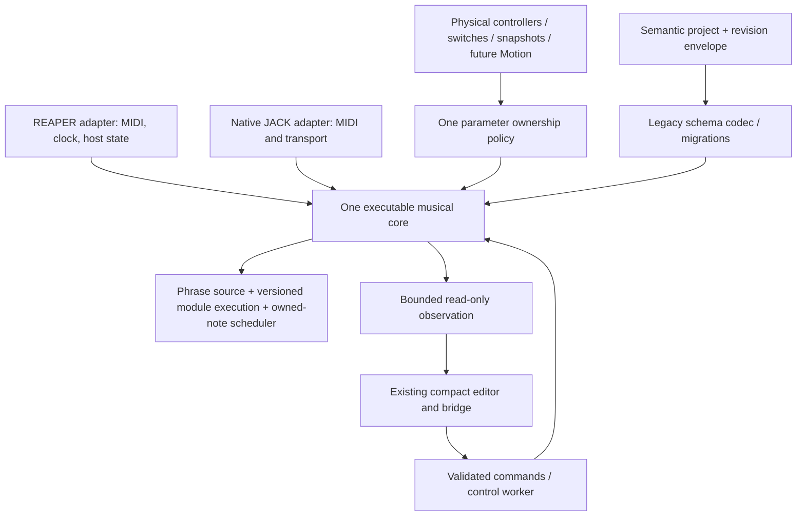

# MIDI BAD MOTHER FUCKER: architectural retrospective

Reviewed 10 October 2026. Report-only audit: no runtime changes, merges or PR closures.

## Scope and evidence standard

The audit fetched current remote branches and read GitHub PR metadata, code, tests,
checkpoints and issue #32. Main is `ab37a752693bf7d2d126a3a9e1ca1c863a5826a9`;
implementation stack tips are #30 `50b5db4`, #34 `243f10f`, #37 `2bec9f6`,
#38 `6bc7b7b`. Source links below deliberately pin #38 rather than assume those
features exist on main. HUMANIZER #25 is `69ff1c2`; scheduler #28 is `d7e6b7e`.

**Confirmed** means directly observed code, metadata or reproduced result.
**Risk** means a plausible failure needing a targeted experiment; it is not a
reported field failure. **Recommendation** is proposed future work, not delivered
functionality. No Raspberry Pi, physical Zynthian, Helix or actual REAPER execution
was available. No claim of hardware reliability or complete studio/live parity is made.

## A. Executive assessment

**We are not yet building the simplest robust implementation of the stated
studio/live instrument. We do have a useful foundation worth preserving.** The
largest problems are a widening semantic split between hosts, positional legacy
persistence, and substantial product work accumulated in drafts. A wholesale
rewrite would add risk without first resolving those problems.

Strong decisions:

- Running the existing JSFX through ysfx preserves much actual musical behavior.
  Native and studio are not two completely unrelated note engines. The real EEL2
  test harness is more valuable than a mathematical simulation alone.
- Native processors have independent processes, sockets and data directories;
  shared JACK transport does not mean shared phrase memory. This is a reasonable
  reliability boundary for Piano/Bass/Synth. Keep it.
- Bounded MIDI queues and chronological output ordering address concrete live
  safety needs. Ownership and lifecycle cleanup have substantial regression
  coverage. They are not reasons to promise unrestricted new module placement.
- Controller token ownership is the right reusable control infrastructure.
  Snapshot morphs and a future Motion envelope should use it instead of competing
  writers. Snapshot effective-state capture is the right musical semantics.
- Browser, file parsing and bridge networking are outside the MIDI callback.
  Committed project restoration does not require a browser or desktop companion.
- Refusing unsupported configurations is safer than erasing them. The current
  parity refusal is honest, even though it does not meet the final product goal.

Where I would decide differently today: I would stop expanding platform-specific
performance features until the shared control/transport boundary was executable on
both hosts; define a semantic project model before growing another raw-memory
consumer; and insist on one small, complete musical workflow per PR. My earlier
choice to layer native snapshots and a rich transfer mechanism before closing
those seams increased integration work and user-visible exceptions.

## Current delivery truth

| Area | Main / drafts | Actual supported level |
|---|---|---|
| Runnable JACK/ysfx host, native chain adapter | #19–24, #27 merged | Independent processors, fixed two-bar synchronized prototype; physical deployment unqualified |
| Controller policies and token morph core | #21/#23/#29 merged | Native ownership/control infrastructure; not equivalent JSFX studio execution |
| Compact native UI, snapshot manager | #30 draft | Capture/update/rename/duplicate/reorder/delete, inclusion, timed and A/B morph, switch actions; substantial limitations below |
| Source MIDI interchange | #34 draft on #30 | Validated SMF 0/1 preview/replace/export, native persistence/playback; notes-only interchange |
| Portable carrier and parity checks | #37 draft on #34 | Schema-7 carrier, source timing in seconds, hash/identity validation, limited shared-engine test |
| ReaScript and synchronization | #38 draft on #37 | SEND/GET and STOP-only guarded PUSH/PULL; autonomous committed restore |
| HUMANIZER | #25 draft | C++/EEL algorithm foundation, not routed playable module |
| ECHOCITY | #28 draft | Bounded EEL scheduler prerequisite, not an insertable echo effect |
| Velocity curves | #12 design draft | Design, not delivered module |
| Motion | issue #32 | Specification, not running automation library |
| Phrase-owned Transformer chains | absent | No executable secondary phrase chain |

Design drafts #11, #12, #35 and #36 must not be counted as implementation releases.
Current metadata confirms #30/#34/#37/#38 are open drafts. Main ends with merges
of #27 and #29; the tested top-of-stack application is not the main application.

## B. Architectural debt, with evidence

### 1. Same source engine is not same complete instrument

**Confirmed.** JSFX still owns phrase/note processing, legacy expression and switch
behavior. C++ owns native Controller policy application, snapshot transitions and
extra chain transport. Populated native Controller/Snapshot extensions cannot run
in REAPER: [portable materialization, lines 153–169](https://github.com/petedevries666/midi_human_looper/blob/6bc7b7b/headless/portable_project.py#L153)
explicitly refuses them. The refusal preserves the file; it does not make the
performance portable. A studio sound depending on those owners cannot currently
be recreated simply by transferring the project.

My previous “shared-engine parity” wording was too broad. [The parity test](https://github.com/petedevries666/midi_human_looper/blob/6bc7b7b/tests/portable_parity.cpp#L7)
plays four events through two ysfx instances at 44.1/48 kHz, block 128, with an
empty Transformer chain and a 3 ms tolerance. Its 41 checks include mailbox and
layout checks, not 41 independent musical workflows. It does not run actual
REAPER, the native chain adapter, Controller takeover, complex ARP, snapshots or
multiple processors as one studio/live equivalence test.

### 2. The pedalboard is still a constrained staged engine

**Confirmed.** [JSFX `tf_serial`/`tf_pitch`/`tf_velocity`](https://github.com/petedevries666/midi_human_looper/blob/6bc7b7b/midi_human_looper.jsfx#L1182)
retain fixed stages for legacy instances and enable serial pitch handling through
extra stateless instances. Velocity is accumulated separately; ARP is captured
through [the routing hook](https://github.com/petedevries666/midi_human_looper/blob/6bc7b7b/midi_human_looper.jsfx#L1215)
and processed later. There is no generic arbitrary event continuation chain.
[UI reorder restrictions](https://github.com/petedevries666/midi_human_looper/blob/6bc7b7b/headless/web/app.js#L342)
permit only eligible Transpose/Range neighbours, correctly limiting the claim.

This is a compatibility compromise, not a completed pedalboard abstraction.
Do not attach ECHOCITY to final MIDI output and call downstream processing solved.
Keep legacy stage semantics for old patches; any new serial contract needs an
explicit execution version and scheduled continuation identity.

### 3. Descriptors do not yet remove duplicated parameter knowledge

**Confirmed.** `modules/catalog.json` and [Python Registry](https://github.com/petedevries666/midi_human_looper/blob/6bc7b7b/headless/registry.py#L7)
are useful editor metadata. But [C++ parameterCount/kind/ranges](https://github.com/petedevries666/midi_human_looper/blob/6bc7b7b/headless/parameter_registry.hpp#L8)
and [browser target eligibility](https://github.com/petedevries666/midi_human_looper/blob/6bc7b7b/headless/web/app.js#L252)
repeat type/kind/range knowledge. Registry lifecycle fields are required strings,
not proof that the runtime executes every named hook. A descriptor is not yet a
complete executable module contract. Drift is a risk; no particular numerical
mismatch is asserted here.

### 4. Portable v1 is an envelope around legacy storage

**Confirmed.** [Portable dimensions and offsets](https://github.com/petedevries666/midi_human_looper/blob/6bc7b7b/headless/portable_project.py#L13)
encode 171,649 numeric cells, 16 phrases and frozen schema-7 addresses. The validator
also knows instance-code storage locations. This minimized migration risk initially,
but makes portability depend on internal memory layout and sample-timing knowledge.
The portable module imports server validation, and the server imports portable
handling: a lazy import works around responsibility coupling, not a clean layering.

Hashes, immutable revision ancestry and rejection of unknown fields are useful.
They provide corruption/conflict detection, not semantic compatibility or signed
authenticity. Unknown data is preserved by refusal; it is not generally editable or
executable. Do not advertise universal unknown-module round trips.

### 5. Control and transport logic accumulate in one host

**Confirmed.** At the reviewed tip JSFX is 4,249 lines and `engine.cpp` 2,758.
[Snapshot recall](https://github.com/petedevries666/midi_human_looper/blob/6bc7b7b/headless/engine.cpp#L1511)
resolves identities, creates owner targets, normalizes parameters and stages a
batch inside the host. [ChainMode](https://github.com/petedevries666/midi_human_looper/blob/6bc7b7b/headless/chain_mode.hpp#L17)
compiles strings that mutate JSFX variables and distant memory. This is an adapter
that also supplies musical behavior. Every new module must currently understand
several seams, increasing maintenance cost even without an observed failure.

### 6. Several persistence authorities require explicit reconciliation

**Confirmed.** Native slot `patch1.json`, immutable `projects/active.json`, Zynthian
extended snapshot, REAPER RPP/JSFX state and desktop bridge baseline coexist.
[Zynthian restoration](https://github.com/petedevries666/midi_human_looper/blob/6bc7b7b/zynthian/zynthian_engine_mbh.py#L63)
gives an explicit snapshot priority over active portable restore;
[adapter SAVE](https://github.com/petedevries666/midi_human_looper/blob/6bc7b7b/zynthian/zynthian_engine_mbh.py#L101)
writes a slot, not the active portable revision. That is not inherently corruption,
but “SAVE then restart” has different outcomes depending on which authority resumes.
This needs a user-visible contract and reconciliation tests before release.

Atomic replace/fsync [ProjectStore](https://github.com/petedevries666/midi_human_looper/blob/6bc7b7b/headless/project_sync.py#L17)
is more durable than some slot save paths. Do not conflate atomic file visibility,
engine activation, multi-process global transactions and power-loss recovery.

## C. Critical live and parity risks

| Priority / certainty | Evidence and consequence | Required qualification |
|---|---|---|
| P0 confirmed parity gap | Native control/snapshot refusal in REAPER, above | Choose one shared executable control policy; cross-host performance traces before claiming parity |
| P0 confirmed grid approximation | `ChainMode::tick` lines 109–110 rounds two bars to whole blocks | Bound/declare musical error; test changing buffer/rate and common tempos with real JACK BBT |
| P0 confirmed incomplete product | No playable HUMANIZER/ECHOCITY/Motion or phrase chains | Release only supported capability matrix; never expose inert controls |
| P0 risk, not proved RT fault | Callback builds large replies, scans state and computes snapshot dirty checks | Measure worst-case callback time, stack/heap activity, XRUNs on Pi with multiple editors and chains |
| P0 recovery qualification gap | Activation precedes manifest commit; rollback relies on successful communication/storage | Kill/power-failure matrix at each activation phase; ambiguous outcome must be inspectable |
| P0 risk of scope mismatch | Recovery emits CC64/123/120 on all 16 output channels | Test shared destination/channel cases; document processor-port ownership before calling it isolated cleanup |
| P1 confirmed diagnostic limit | Host `held` is boolean per channel/pitch, not counted | Distinguish diagnostic active count from true ownership; never use it alone as no-stuck-note proof |
| P1 hardware unknown | Cloud buffers, mocks and algorithm tests dominate available evidence | Pi latency/CPU/RAM, device reconnect and actual REAPER/Firefox qualification |

Reproducible grid example (120 BPM): `round(rate * 480 / tempo / block) * block`
is the implementation's intended nearest-block formula. At 48 kHz/block 128 the
ideal and actual are 192,000 samples. At block 8,192 the actual is 188,416:
**74.67 ms short**. At 44.1 kHz/block 128 it is 176,384 instead of 176,400:
0.363 ms short. Python reproducer: `print((round(48000*480/120/8192)*8192 -
48000*480/120)/48000*1000)`. This is a confirmed approximation, not evidence of
random drift between processors sharing the same grid. Different configurations
can disagree. The exact-grid portable guard can reject rather than adapt such
projects. Tempo changes stop playback instead of silently retiming recordings
([lines 115–137](https://github.com/petedevries666/midi_human_looper/blob/6bc7b7b/headless/chain_mode.hpp#L115)).

Real-time positives and limits:

- Native queues/pools are preallocated; parsing/file IO occurs in control workers.
  Stable timestamp ordering is preserved by [ordinal-tied sorting](https://github.com/petedevries666/midi_human_looper/blob/6bc7b7b/headless/engine.cpp#L2595).
- [Input processing](https://github.com/petedevries666/midi_human_looper/blob/6bc7b7b/headless/engine.cpp#L1859)
  budgets 128 events per callback. Deferred inputs have offsets reset to zero;
  bounded overload processing trades timestamp fidelity for bounded work.
  A queue existing within bounds is not proof of low latency during bursts.
  The output drain also budgets 64 events per call (`flushOutput`, engine lines
  1772–1787), with deferred output offsets reset. Burst-delay tests must cover
  both admission and emission rather than only successful chronological sorting.
- [Maintenance pauses](https://github.com/petedevries666/midi_human_looper/blob/6bc7b7b/headless/engine.cpp#L1854)
  defer processing, while snapshot publication runs in the callback. A browser
  websocket [requests full state four times/second per client](https://github.com/petedevries666/midi_human_looper/blob/6bc7b7b/headless/server.py#L116);
  replies copy full bounded structures and calculate dirty state
  [here](https://github.com/petedevries666/midi_human_looper/blob/6bc7b7b/headless/engine.cpp#L1715).
  No callback lock or unbounded heap allocation was identified in these paths;
  **bounded does not mean cheap**, and this was not an exhaustive allocator audit
  of ysfx/JACK or third-party code.
- Three 8,192-packet arrays with 256-byte payloads alone reserve about 6.49 MB per
  native process (264-byte packets on the reviewed layout), before EEL memory,
  snapshots, control queues, interpreter, Python/web processes and libraries.
  Three independent hosts multiply baseline memory. No Pi RSS/CPU budget was
  measured. This estimate is not total RAM and not a reason to prematurely share VMs.
- [Boolean held diagnostics](https://github.com/petedevries666/midi_human_looper/blob/6bc7b7b/headless/engine.cpp#L2575)
  can underrepresent overlapping repeated pitches; the JSFX has counted routing
  ownership and tests use counted ledgers. This is not proof of a current stuck
  note. Review admission guards using all authoritative owners, not the counter alone.
- SIGTERM cleanup and PANIC are implemented; SIGKILL, hardware disconnect, a lost
  output port or power loss cannot guarantee delivery of releases. Reconnection
  must reset the destination safely; automatic replay must never be assumed safe.
- Engine independence from browser is supported. Unexpected native child failure
  is not a fully supervised recovery design: adapter checks startup and owns child
  shutdown, but has no demonstrated runtime restart/reconnect guarantee. Keep
  failures visible; do not restart into autoplay.

## D. Simplification and user experience

Keep a compact phrase row and instrument row. [Current phrase renderer](https://github.com/petedevries666/midi_human_looper/blob/6bc7b7b/headless/web/app.js#L309)
provides six-per-page, direct REC/TRIGGER/Learn/Solo/Mute and mode/velocity controls.
However labels are generated, no phrase Transformer secondary row exists, native
chain mode disables ONCE/HOLD, and FINISH/events/options add width. Do not claim
full mandatory UX compliance. Preserve existing working controls while testing
actual small-screen/touch usability.

[Controller editing](https://github.com/petedevries666/midi_human_looper/blob/6bc7b7b/headless/web/app.js#L255)
exposes numeric takeover/return/easing enums alongside explanatory prose. Use named
choices and sensible defaults; display one target plus advanced options, not a
policy spreadsheet. [Switch popup](https://github.com/petedevries666/midi_human_looper/blob/6bc7b7b/headless/web/app.js#L85)
is a snapshot override editor, not full native legacy switch configuration.
Do not create yet another switch editor to fill that gap.

Whole-project transfer requires a Python companion, private token/spool pairing,
STOP on both sides and exactly one recognized track JSFX across every open REAPER
project ([scope checks](https://github.com/petedevries666/midi_human_looper/blob/6bc7b7b/reaper/MBMF_Studio_Live_Bridge.lua#L40)).
This is a cautious first bridge, not frictionless three-chain studio mirroring.
Phrase SEND/GET is simpler and should remain usable independently. Collapse paired
connection details after setup; expose explicit source, destination, last committed
revision, dirty/conflict state and unsupported capabilities in one place.

Reduce users' decisions by defining: one authoritative project per processor,
SAVE as a deliberate persistent checkpoint, snapshots as performance values inside
that project, transfers as source-data operations by default, and no autoplay on
restore. Do not add DAW-style arrangement, nested routing or Motion UI until this
workflow is dependable.

## E. Keep / Refactor / Replace / Remove

| Component | Decision | Justification / boundary |
|---|---|---|
| JSFX musical core / ysfx | Keep now; refactor seams | Real regression history and studio compatibility outweigh rewrite appeal |
| C++ JACK host | Keep; refactor | Port/thread/queue adapter should not accumulate new musical policy inline |
| Native two-bar ChainMode | Refactor, not silently replace | Explicit constrained mode; centralize transport contract and correct grid semantics with migration |
| Native Controller token policy | Keep; share execution | One owner model for physical, snapshot and future Motion sources |
| Legacy expression/learn | Keep compatibility adapter | Translate ownership through shared target identities; do not erase patches or create a third learn system |
| Snapshot manager | Keep native feature; refactor integration | Useful performance primitive; promote parity as a prerequisite, not retrospective promise |
| Module metadata | Keep; make source authoritative | Generate runtime IDs/ranges/capability checks; fields alone do not implement hooks |
| Raw schema-7 codec | Keep read/write compatibility | Treat as adapter, not future semantic project authority |
| Portable hashes/revisions | Keep | Good conflict/integrity envelope; move layout knowledge behind codec |
| Multiple ad hoc save implementations | Consolidate | One storage transaction utility and documented restoration precedence |
| Python HTTP/browser | Keep lightweight | Standard-library runtime; browser stays out of scheduling; bound observation overhead |
| ReaScript asynchronous companion | Keep minimal bridge | Solves source transfer without MIDI-thread networking; do not enlarge it into another engine |
| #25 algorithm dual implementations | Keep tests; choose runtime path | Differential tests useful; do not ship two independently evolving schedulers |
| #28 EEL scheduler | Keep isolated until integrated | Shared bounded continuation/ownership is preferable to native post-output echo |
| Motion designs | Defer implementation | Future client of Controller tokens; not another target/learn/persistence engine |
| VST3 | Do not adopt as rewrite now | Packaging alone does not solve parity, transport or legacy migration |
| Stale checkpoints / duplicated status claims | Remove after consolidation | One current capability/release matrix; preserve historical evidence as clearly dated archive |

A VST3 wrapper could eventually expose the same executable core to multiple REAPER
instances and scoped host state. It is justified only if actual JSFX embedding
constraints cannot support shared control parity or instance addressing. Budget
host SDK/build/distribution, MIDI timing, saved-state compatibility and regression
cost first. A second C++ musical implementation behind a VST3 would worsen parity.

## F. Prioritized roadmap and release gates

### P0: correctness and delivery blockers

1. Qualify and integrate the existing core stack, not effects. Review #30 as several
   internal change groups (lifecycle, controllers/snapshots, UI); require executable
   three-processor record/play/overdub/save/restart/PANIC acceptance. Do not merge
   the bundle merely because this report exists.
2. Write one transport/capability contract: fixed native grid limitations, sample
   rate/block/tempo policy, host loss and exact same-timestamp ordering. Add actual
   adapter parity tests. Fix block-rounded musical timing before promising parity
   across host settings; preserve old patches with explicit execution semantics.
3. Resolve persistence precedence and crash ambiguity. Test slot SAVE vs active
   manifest vs Zynthian snapshot, failure after engine apply, rename/fsync failure,
   process kill between phases and restart. Current injected-failure coverage is
   valuable but is not a power-cut campaign.
4. Complete shared Controller/Snapshot execution or publish an explicit smaller
   interoperable release profile. No silent fallback; parameter/type coverage
   matrix must accompany any “same performance” claim.
5. Physical qualification: three chains, 128/256/512-frame settings as supported,
   MIDI bursts/repeated pitches/sustain, multiple editors, browser loss, controller
   unplug/replug, JACK port loss, STOP/PANIC and restart. Measure callback deadline,
   XRUNs, RSS and CPU. Publish results and failures; no universal numbers invented.

### P1: reduce structural debt

1. Extract codec/validation from server; generate stable parameter kinds and
   normalized conversions from the catalog and test generated parity.
2. Isolate host adapter, parameter-owner application and observation publication
   without changing algorithms. Publish bounded compact state/deltas rather than
   recomputing everything per observer request; verify benefit before optimizing.
3. Consolidate storage utilities and status documentation. Name protocol operations
   in one generated contract instead of extending magic op/kind values by hand.
4. Define versioned serial event continuation and cancellation contract before
   merging #28 into a product effect. Port legacy chains through an explicit staged
   execution adapter. Add phrase-owned chains only after ownership is unambiguous.
5. Complete one playable HUMANIZER or forward ECHOCITY vertical slice using that
   scheduler; test downstream transforms and lifecycle, not just hash arithmetic.

### P2: optional refinement

Evaluate scoped plugin packaging only with a proven need. Add Motion as a bounded
control-source client after shared ownership/parity is established. Defer Reverse,
complex multi-tap, arbitrary layouts and advanced transport until the release
profile is playable. Standalone Raspberry Pi packaging needs adapter/install work,
not Zynthian-specific hardware dependencies or a new musical engine.

## G. Proposed simplest realistic target



“One core” means executable semantics, not merely equal parameter labels. Keep
JSFX/EEL2 as the deployed note core now. Decide with a bounded parity spike whether
Controller/Snapshot policy can execute as shared EEL2 or a shared core can be
hosted appropriately in REAPER. Do not select a C++ rewrite in this audit. Until
then identify native-only policy honestly. File/network work remains outside the
core; host transport supplies clock facts, while one musical contract defines what
those facts mean. One independent core instance per processor remains appropriate.

Use a semantic project view with stable instrument/module/phrase targets and source
MIDI time units; preserve unknown opaque extensions. Existing raw schema-7 codecs
remain import/export adapters. Migrate incrementally, not by forcing old projects
through a new incompatible representation. A smaller Pi can run the same native
host/editor with a standalone launcher; Zynthian registration is an optional
lifecycle/routing adapter. No full Zynthian hardware kit should be a core dependency.

## H. Safe PR integration and migration

Dry-run `git merge-tree --write-tree` results, without touching the worktree:

- Main → #30: clean tree synthesis; #30 contains current main ancestry.
- #38 + #25: conflict in `docs/issue-18-checkpoint.md`; other examined paths
  auto-merge. This is syntactic evidence only, not semantic compatibility.
- #38 + #28: conflict in `tests/expression_host.cpp`; JSFX auto-merges. An
  auto-merged scheduler does not prove lifecycle, timing or Controller parity.

Recommended order: validate #30 first, then #34, #37, #38, rerunning tests after
changing each base. Keep drafts #25/#28 isolated until the serial continuation
contract and playable module slice are reviewed. Designs #35/#36 can later be
superseded explicitly by implementation references, not merged as runtime features.
No merges or closures were performed in this audit.

#30 is 34 changed files, 3,251 insertions and 204 deletions relative to current
main. It combines native integration, snapshots, lifecycle and UI. The linear
stack is mechanically understandable but expensive to review and requalify. Do
not force-push others' work to cosmetically split it. Use a documented review map
and small subsequent fixes; any dependency rebase must preserve commits and
rerun the actual combined stack tests.

Migration safeguards:

1. Freeze a tested release profile and immutable patch fixtures from each schema.
2. Introduce codecs/generated metadata behind existing APIs; compare old/new
   decoding and emitted MIDI traces before changing defaults.
3. Add transport/execution version fields with explicit migration and rejection.
   Old patches retain their known semantics; users opt into changed processing.
4. Introduce one shared policy path with shadow/differential tests, not two live
   writers. Snapshot and physical takeover must agree before cutover.
5. Migrate persistence authority with backups, hashes and explicit restart policy;
   never autoplay or strip unknown data. Keep rollback readers while fixtures pass.
6. Only then enable new effects/chains. Test deleting/bypassing/reordering with
   sounding notes and controller/snapshot references, including repeated pitches.

## Test evidence and gaps

During this audit, on #38's binary/source tip, executed:

```sh
HEADLESS_BINARY=/workspace/scratch/midi-headless-engine-sync-final \
  /workspace/setup-tools/venv/bin/python tests/test_project_sync.py
/workspace/setup-tools/venv/bin/python tests/test_reaper_bridge.py
/workspace/setup-tools/venv/bin/python tests/test_portable_project.py
```

Results: one real HTTP/native sync scenario passed; four Lua/REAPER-API-mock bridge
tests passed; six portable contract tests passed. No runtime modifications were
made. The previously executed complete combined suite passed on the implementation
stack; it was **not rerun in full for this report**. That distinction matters.

Tests worth keeping: actual shared EEL2 execution, counted JACK note ledger,
three independent processors, transactional MIDI import/export with mido as an
independent parser, Controller ownership interruption and injected persistence
failure. `mido`, `lupa`, Playwright and cached ysfx are development/test dependencies;
the Python runtime bridge uses standard-library networking, not these test tools.

Gaps: actual REAPER API execution and export fixture, complete adapter parity with
ARP/controllers/switches/snapshots, Firefox's full generic editor workflow, hardware
latency/CPU/memory, power-cut recovery, runtime child supervision and device/port
reconnection. [Combined runner](https://github.com/petedevries666/midi_human_looper/blob/6bc7b7b/scripts/combined-test.py#L45)
runs extra generic/editor/controller/snapshot/product/MIDI browser cases only for
Chromium; selecting Firefox does not imply the same matrix passed. Many tests are
necessary layered checks, not obvious duplicates. Algorithm millions-of-checks
counts must not substitute for end-to-end live acceptance.

Documentation debt is reproducible: [snapshot checkpoint lines 99–127](https://github.com/petedevries666/midi_human_looper/blob/6bc7b7b/docs/global-snapshots-manager.md#L99)
still lists compact controls/add-delete/Learn as future work, while current renderer
and [product status](https://github.com/petedevries666/midi_human_looper/blob/6bc7b7b/docs/product-integration-status.md#L55)
describe their implementation. Some items, notably phrase chains, genuinely remain
absent. Replace conflicting current-status sections with one matrix; archive dated
checkpoints. Do not casually delete old evidence or “fix” claims by marking partial
features complete.

## Final engineering judgment

Keep the deployed engine and proven safety work. Stop treating a tested carrier,
a scheduler foundation or an auto-merged branch as a complete musical capability.
The shortest route to a maintainable instrument is to integrate the stable stack,
qualify one real performance workflow, and close the shared control/transport and
persistence seams. More features before those gates would increase the number of
exceptions a musician must understand, rather than make studio-to-live performance
simpler.
